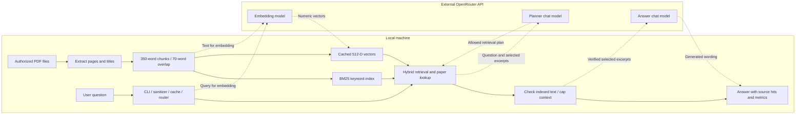
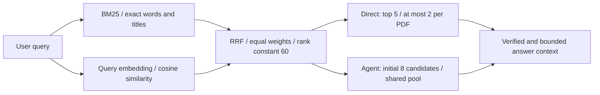
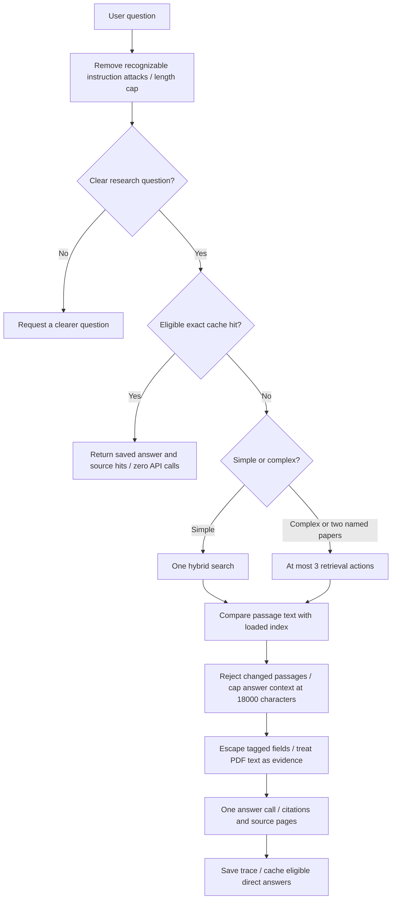
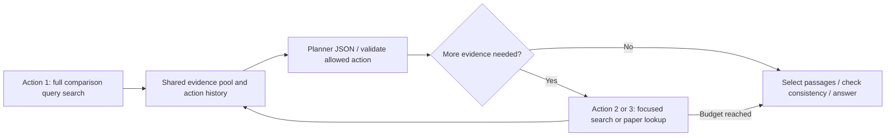
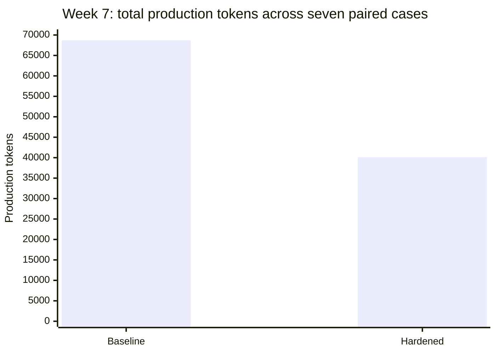

# Research Paper Navigator

Final capstone for the MIT xPRO RAG and Context Engineering course. The navigator answers questions about research-paper PDFs, using keyword and semantic retrieval, a bounded retrieval agent, and citations to the selected paper pages.

The original collection contains **153 PDFs and 12,420 overlapping chunks**. The final system carries forward the tested Week 2 hybrid retriever, Week 5 retrieval functions, and Week 7 safeguards. A portable command-line interface adds ordinary question answering, recorded demonstrations, and reproducible evidence summaries.

## Install

Python 3.10 or newer is required. From this repository directory:

```sh
python -m venv .venv
# Windows PowerShell
.venv\Scripts\Activate.ps1
# macOS/Linux: source .venv/bin/activate
python -m pip install -r requirements.txt
```

## Review without an API key or PDFs

```sh
python navigator.py check
python -m unittest discover -s tests -v
python navigator.py summary
python navigator.py replay --case P1 --arm hardened
python navigator.py replay --case S1 --arm baseline
python navigator.py replay --case S1 --arm hardened
```

`replay` displays saved Week 7 model wording, clearly labeled as a recorded demonstration. It does not generate a new answer. The tests use small synthetic chunks and mocked provider replies to exercise the actual direct path, hybrid rank fusion, named-paper agent, integrity checks, and cache behavior. These are implementation checks, not accuracy benchmarks.

## Configure live questions

PDFs are local inputs, not repository contents. Put your authorized PDF copies directly inside `data/papers/`, or pass `--corpus` with another folder. `data/sample_papers/README.md` identifies two publicly available demonstration papers and their source pages. The CLI falls back to that folder if it contains your local copies. Historical experiment scores refer to the full 153-PDF collection, not a two-paper sample. `data/corpus_manifest.json` inventories the original collection without distributing its PDFs.

Set the key in your process environment. `.env.example` documents variable names but the program does not automatically load it.

```powershell
# Windows PowerShell. Supply your own key locally.
$env:OPENROUTER_API_KEY = '<your key>'
$env:RPN_CORPUS_DIR = 'C:\path\to\ResearchPapers'
```

```sh
# macOS/Linux
export OPENROUTER_API_KEY='<your key>'
export RPN_CORPUS_DIR='/path/to/ResearchPapers'
```

The default chat model is `openai/gpt-5.4-mini`. Override it with `--model` or `RPN_CHAT_MODEL`. Embeddings use `openai/text-embedding-3-small` at 512 dimensions. Your OpenRouter account must support the configured models and have sufficient credits. Changing a chat model also changes the answer-cache key.

```sh
python navigator.py ask "How does Learning to Infer Program Sketches combine a neural model with symbolic program synthesis?" --save outputs/method.json
python navigator.py ask "Compare Learning to Infer Program Sketches with Program Synthesis with a REPL. How does each combine learning with symbolic search or execution feedback? For each paper, report one evaluation or scope trade-off stated by its authors." --save outputs/comparison.json
python navigator.py keyword "Learning to Infer Program Sketches symbolic search"
```

The first live run extracts PDF text and embeds the corpus, which can take several minutes and incur API charges. Later runs reuse `.cache/`. Live mode sends embedding inputs and selected excerpts to OpenRouter. `keyword` searches locally with BM25 and does not generate an LLM answer. `--no-cache` forces a new live answer. `--cache-dir` selects a separate cache location.

## How the final workflow works

### Architecture and external-data boundary



Dashed connections cross the local-data boundary. Live questions send text to OpenRouter. The tool allowlist prevents the *planner* from requesting arbitrary uploads or file deletion, but the application intentionally uses approved embedding and chat APIs. Offline tests, summaries, and replay require no provider access.

### Hybrid ranking



BM25 handles exact terminology. Embeddings handle similar meaning. Reciprocal rank fusion (RRF) combines ranking positions instead of comparing incompatible raw scores. The per-PDF limit does not merge different versions of the same study.

### Question workflow and guardrails



An exact cache hit also requires matching corpus fingerprint, chat model, and policy version, with seven-day expiry. Pronoun-dependent questions do not qualify. A cache hit preserves the original answer's errors as well as its wording.

### Bounded agent example



The saved Week 8 comparison searched the full question, looked up the REPL paper, and then looked up the Sketches paper. REPL means read-eval-print loop. A program sketch is an incomplete program with holes. These are paper names in the recorded example, not hard-coded targets for every question. Coverage rules can override an early answer plan to retrieve passages for up to two papers named in the actual question. Invalid or unknown planner actions stop further retrieval, subject to that coverage rule. There is no arbitrary code execution or general-purpose file tool.

1. Extract text page by page with pypdf. Split pages into 350-word chunks with 70-word overlap, preserving the PDF filename and page.
2. Rank chunks with BM25 and cosine similarity. Combine the two ranks with equal-weight reciprocal rank fusion, with rank constant 60. Limit repeated passages from a PDF.
3. Remove recognizable role commands and pasted fake-source blocks. Escape tagged prompt fields and treat retrieved text as evidence, never as instructions.
4. Route simple questions to one search and one answer. Comparison, evaluation, scope, limitation, and benchmark questions use a bounded agent. At most three retrieval actions are available: one initial search and up to two further searches or paper lookups.
5. Derive explicitly named papers from the question and corpus titles, rather than supplying evaluation answer labels to the live system. Focused lookups and selection reserve evidence for up to two named papers.
6. Compare selected text with the loaded index copy. Cap answer context at 18,000 characters and each passage at 4,400. Generate an answer with numbered citations and source pages.
7. Reuse a successful direct answer for an identical normalized, self-contained question within seven days, under the same corpus, model, and policy. The final CLI retains source hits with cached wording. Paraphrases miss this exact cache.

This is a sequential local CLI, not a concurrent web service. Historical experiments used known title anchors in their test harness. The final CLI derives anchors from the actual query. The final wrapper extends the Week 7 harness cache to ordinary direct questions and preserves their source metadata. Historical measurements still refer to the original Week 7 experiment, not a new benchmark of the wrapper.

## Guardrails and what they do not guarantee

| Boundary | Implemented control | Remaining limitation |
| --- | --- | --- |
| User input | Narrow instruction/block filters, XML escaping, 1,200-character query cap | Novel attacks may pass. Legitimate quotations may be removed. |
| Planner tools | JSON parsing and allowlist: `search`, `lookup_paper`, `answer` | A valid plan can still choose weak evidence. This is not a sandbox for general tools. |
| Retrieval effort | Three retrieval actions including the initial search, repeat prevention, coverage for two named papers | Broad questions may need more evidence than the fixed budget allows. |
| Passage consistency | SHA-256 comparison with the loaded index copy | Detects changed text relative to that copy, not falsehood or poisoning already present at ingestion. |
| Context | 4,400 characters per passage, 18,000 total answer-context characters | Important tables or qualifications may be truncated or absent. |
| Answer generation | Evidence-only prompt, requested numbered citations, explicit instructions to state missing evidence | No independent automatic claim-support verifier. Citation errors remain in saved results. |
| Reuse | Exact cache scoped by corpus/model/policy and seven-day expiry | No semantic cache. Reuse does not improve answer correctness. |
| Repository publication | Environment-only key loading, explicit upload inventory, secret/private-path scan | A pattern scan cannot certify that arbitrary business information is non-confidential. |

These controls reduce specific risks. They do not establish clinical safety, regulatory suitability, or complete prompt-injection resistance. Corporate use requires approved data handling and access controls. The current project has no company authentication/authorization layer.

## Evaluation evidence

All JSON files in `evidence/` preserve saved experimental results. Local course paths in location metadata are changed to relative `course/` references. Generated answer strings remain unchanged. These references identify earlier course artifacts and are not imports required by the final code.

| Experiment | Observed result | Interpretation |
| --- | --- | --- |
| Week 3: eight questions | Expected source in top five for 7/7 answerable cases. Judge passed 8/8, but combined acceptance was 7/8. | An independent abstention guard caught an unsupported identification the judge accepted. |
| Week 4: six broad questions, paired retrieval paths | Both paths passed 6/6 rubric checks. Distinct filename slots increased from 23 to 27 with decomposition. | Wider coverage did not establish better answer accuracy. Duplicate versions can inflate diversity. |
| Week 5: three multistep questions | Fixed search and initial agent passed 2/3. Refined agent passed 3/3. | Focused evidence selection helped on this small set. |
| Week 6: model-choice audit | Current and mixed setups passed 3/3 ordinary questions. All-cheaper setup passed 0/3. | Lower provider cost alone did not justify changing both models. |
| Week 7: seven paired cases | 68,687 to 40,115 production tokens, 76.004 to 38.094 observed seconds, $0.07200673 to $0.044558 reported cost. | 41.6% fewer tokens and 38.1% lower reported cost in one small sequential run. |
| Week 7: exact repeat | Identical saved answer with zero API calls. | Local cache savings apply only to eligible repeats. |

Different weeks used different questions and rubrics. Do not treat these rows as one comparable accuracy trend. Week 7 totals exclude corpus index construction, the cache repeat, and superseded iterations. Provider timing and pricing vary. Week 7 has no independent source-aware judge score.

The final Week 8 interface was also checked with a live method question, a live two-paper comparison, and an exact repeat. The repeat used zero API calls. The comparison exposed an extracted-title suffix issue, which was corrected and covered by a regression test. It also retained a claim-to-citation mismatch, documented in `evidence/final_interface_review.txt`. These are functional checks, not an independently graded accuracy benchmark. Full generated wording and source hits are preserved in the separate `final_interface_*.json` files.

### Recorded production-token comparison



The same values are in the table above, so the evidence remains readable without diagram support. The 41.6% reduction excludes index construction, cache repeats, and superseded iterations. It does not measure answer-accuracy improvement.

## Scripts and reproducibility

```sh
# No network, API key, or PDFs needed:
python scripts/run_checks.py
python scripts/verify_evidence.py
python scripts/scan_repository.py

# Preview the three Week 5 questions without sending them anywhere:
python scripts/run_questions.py --test-set evidence/test_sets/checkpoint_5_1_test_set.json

# Explicit opt-in: run the current final system, not the historical three-arm harness:
python scripts/run_questions.py --test-set evidence/test_sets/checkpoint_5_1_test_set.json --execute --corpus data/papers --output outputs/current_run.json
```

`run_questions.py` uses only question strings, never grading notes, expected-source labels, or expected titles to guide the live system. Its default is an offline preview. `--execute` uses the configured provider and can incur charges. It refuses cases that require synthetic PDF overlays because the portable runner does not reproduce those audit conditions. The saved test sets and logs document historical experiments. Re-running the final system does **not** reproduce earlier baselines, decomposition arms, model audits, or judge scores. No new live experiment was performed as part of this documentation update.

`scripts/run_checks.py` runs the offline implementation tests, evidence checks, repository scan, and historical summary. `scripts/verify_evidence.py` validates JSON, test-set counts, required evidence files, and Week 7 log/answer consistency. It does not grade factual accuracy. See [the evidence inventory](evidence/README.md) for exact files and provenance.

## Known limitations

- PDF extraction can flatten tables and misalign column labels. A final Week 7 answer rejected an invented statistic but still mixed full-dataset and filtered-test results. Numeric claims require inspection of the actual paper table.
- Regex filters miss novel attacks and may remove legitimate quoted instructions. Prompt tags do not guarantee attack resistance.
- Integrity checks reject text changed after ingestion. A misleading or poisoned PDF already present at ingestion can still match the stored text.
- Conference and preprint duplicates remain. File diversity does not equal distinct studies.
- Exact title detection is conservative and can miss shortened names. The action cap supports at most two focused named-paper lookups. Broad questions may still have gaps.
- Cached answers reuse their original quality. There is no independent automatic factual validation before caching. Disable caching when checking revised findings. PDF updates are observed when the corpus is reloaded, not by a background watcher.
- Extraction caching uses filenames, file size, and modification time. A content change that preserves all of those could evade cache invalidation. Delete `.cache/` locally to force reconstruction after such a change.
- The small test sets and shared answer/judge model have blind spots. There is no multi-turn memory or production load evaluation.

## Project files

- `navigator.py`: supported command-line entry point.
- `src/research_navigator/`: hybrid retrieval, bounded agent, safeguards, and portable interface.
- `tests/`: deterministic offline integration checks.
- `evidence/week2_results.json` through `week7_results.json`: historical traces, questions, outputs, and measurements.
- `evidence/week7_answers_verbatim.log`: the historical Week 7 run log, including iterative answers.
- `evidence/logs/`: Week 2 baseline/hybrid and Week 3–6 experiment logs.
- `evidence/test_sets/`: recorded Week 2–7 questions, grading notes where available, and synthetic audit definitions.
- `scripts/`: offline checks, publication scan, and an explicitly opted-in current-system question runner.
- `data/corpus_manifest.json`: original PDF inventory. `data/sample_papers/README.md` identifies local demonstration inputs.

## Publication boundary and future work

The repository contains source code, tests, recorded research questions, selected research-paper excerpts, generated answers, and measured results. It excludes API keys, live caches, new user outputs, full PDFs, presentations, narration, course worksheets, and submission-only instructions. Local `course/` references in historical location metadata are provenance labels, not missing Python imports. Private workstation paths in packaged copies are removed. Never add employer documents, patient information, credentials, or confidential prompts to this evidence directory.

Presentation and narration files previously committed to this private repository are removed from the current branch tree. Normal commits retain older versions in Git history. `.gitignore` and the publication scanner prevent their inclusion in the updated package but do not purge existing history.

Proposed improvements include stable passage IDs and claim-support checks, table-aware extraction, canonical study IDs, content-hash cache invalidation, tuning RRF weights, cross-encoder reranking, and independent held-out expert evaluation of coverage-based agent stopping. None of these proposed mechanisms is claimed as implemented or benchmarked here. Medical-device R&D is an intended future use; the course experiments use mostly program-synthesis papers.
